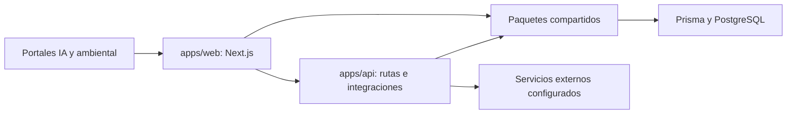

# AquatechIA — IA aplicada, educación y herramientas ambientales

[](https://github.com/Pablo-Cubides/Aquatech-IA_webpage/actions/workflows/ci.yml)

[Sitio del proyecto](https://aquatechia.com) · [Documentación técnica](docs/MASTER_DOCUMENTATION.md) · [Decisiones de arquitectura](docs/adr/)

AquatechIA reúne herramientas educativas de inteligencia artificial y aplicaciones de análisis ambiental en dos portales de un mismo producto. Integra herramientas que antes se mantenían en repositorios independientes y comparte componentes, validaciones y acceso a datos dentro de un monorepo.

## Recorridos para explorar el producto

| Recorrido | Qué permite comprobar | Código |
|---|---|---|
| Aprender cómo funcionan los LLM | Interacción por etapas con conceptos como tokenización, embeddings y generación | [Herramientas del portal IA](apps/web/src/app/(portals)/ia/(marketing)/herramientas/) |
| Analizar datos ambientales | Carga y visualización de datos, cálculos de correlación y herramientas de calidad del agua | [Herramientas ambientales](apps/web/src/app/(portals)/ambiental/(marketing)/herramientas/) |
| Consultar reglas de dominio | Normativa ambiental y matrices con criterios explícitos | [Portal ambiental](apps/web/src/app/(portals)/ambiental/) |
| Revisar una integración de producto | Rutas de autenticación, pagos, créditos y webhooks | [API](apps/api/src/app/api/) |

Las herramientas de aula y consulta de notas tienen reglas de acceso y visibilidad propias; no todas las rutas están pensadas como demos públicas. Las integraciones con cuentas, pagos o proveedores externos requieren su configuración correspondiente.

## Arquitectura



- `apps/web`: interfaz, herramientas interactivas y contenido de ambos portales.
- `apps/api`: endpoints e integraciones de autenticación, pagos y correo.
- `packages/@ia-next`: componentes, contratos, cliente de datos y configuración compartida.
- `specs` y `docs/adr`: requisitos y decisiones, incluyendo separación de portales y organización del monorepo.

**Stack actual:** Next.js 16, React 19, TypeScript, pnpm 8.15.6, Turborepo, Prisma 7/PostgreSQL, Zod y Vitest. Las integraciones incluyen Firebase/NextAuth, MercadoPago, Brevo y Redis/Upstash según la funcionalidad habilitada. Los manifests y el lockfile son la referencia de versiones exactas.

## Desarrollo local

Requiere Node.js 24 y pnpm 8.15.6 para el flujo de desarrollo actual.

```sh
git clone https://github.com/Pablo-Cubides/Aquatech-IA_webpage.git
cd Aquatech-IA_webpage
pnpm install --frozen-lockfile
pnpm dev
```

La web utiliza el puerto 3000 y la API el 3001. Revisa `.env.example` y los ejemplos de cada aplicación; guarda valores reales únicamente en configuración local ignorada o en el proveedor de despliegue. No ejecutes migraciones sobre una base de producción para preparar una demo.

La instalación genera clientes de Prisma y requiere acceso a su distribución de motores. La compilación de fuentes de Google necesita acceso a sus servidores. Una página pública puede servir sin que estén habilitados todos los servicios de negocio.

## Pruebas y calidad

```sh
pnpm --filter @ia-next/web run test
pnpm --filter @ia-next/api run test
pnpm typecheck
pnpm lint
pnpm build
```

Las pruebas cubren cálculos de herramientas, utilidades y componentes, además de rutas de la API. Los tests que usan Prisma requieren el cliente generado; los flujos de autenticación y pagos necesitan sus propias pruebas de integración. El badge enlaza al resultado del workflow real.

## Contexto del portafolio

Este proyecto muestra integración de herramientas de dominio en un producto, organización de un monorepo, componentes compartidos y decisiones técnicas documentadas. Los repositorios archivados de herramientas se conservan como referencias históricas; la implementación mantenida está aquí.

Para evaluar una herramienta concreta, revisa su código, casos de prueba y limitaciones de entrada. Los servicios externos y los datos necesarios varían entre herramientas.

## Documentación y contribuciones

- [Guía principal](docs/MASTER_DOCUMENTATION.md)
- [Decisiones de arquitectura](docs/adr/)
- [Contratos](docs/contracts/)
- [Especificaciones](specs/README.md)
- [Contribuciones](CONTRIBUTING.md)

Código público para inspección. Proyecto personal; todos los derechos reservados. Este repositorio no concede una licencia de código abierto.
