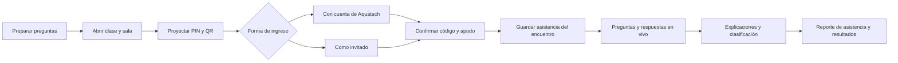

# SPEC-211 — Plan de AquaQuiz

**Estado:** implementación `implementing`. **Fecha:** 2026-10-30. Este plan guía la entrega de código para AquaQuiz. La validación de cuentas reales, el QR y el piloto de carga siguen pendientes; el SQL de la base de datos está preparado y no se ha aplicado a un entorno.

## 1. Propuesta y revisión de las herramientas actuales

Crear **AquaQuiz · preguntas en vivo** dentro de **Autor → Herramientas para docentes**. La experiencia combina concurso de clase, acceso desde el celular y asistencia por encuentro. El ingreso admite cuenta de Aquatech o modo invitado; en ambos casos se usan **código estudiantil y apodo**, sin solicitar nombre completo. El cuestionario se puede preparar por asignatura, unidad, tema y dificultad.

| Herramienta revisada               | Qué existe en el código                                                                                                                 | Cómo aprovecharlo                                                                                                                  |
| ---------------------------------- | --------------------------------------------------------------------------------------------------------------------------------------- | ---------------------------------------------------------------------------------------------------------------------------------- |
| Aula Score                         | Grupos, puntos manuales, cuenta regresiva, temporizador y tema claro/oscuro. La configuración y el marcador viven en el navegador.      | Referencia para marcador y controles del docente; los nuevos resultados serán persistentes y compartidos.                          |
| Ruleta Académica                   | Importación CSV/XLSX, conjuntos guardados mediante `/api/questionsets` y preguntas locales sobre acueductos, saneamiento y tratamiento. | Recuperar enunciados como borradores y usar los mismos temas; completar opciones, respuesta correcta y explicación antes de jugar. |
| Consulta Nota                      | Importación de estudiantes/notas y datos de universidad, curso, código y nombre.                                                        | Mantener términos y formato de archivos familiares. La asistencia tendrá registros propios.                                        |
| Proyectos de Investigación         | Otra tarjeta en la zona de herramientas de Autor.                                                                                       | Mantener el patrón de acceso del catálogo.                                                                                         |
| Página de Autor y `usePortalTheme` | Fondos oscuros, tarjetas redondeadas y acentos cian/azul.                                                                               | Usar esta identidad en la nueva herramienta.                                                                                       |

**Hallazgos que condicionan el plan:** el modelo `Question` actual solo conserva texto, sin opciones ni solución. El importador de Ruleta aplana las celdas del archivo, por lo que no sirve directamente para una plantilla estructurada de quiz. No se identificó un sistema de salas multijugador o asistencia en los modelos revisados. El README y los stubs son referencias parciales; algunas rutas documentadas no coinciden con las rutas reales.

También existen accesos de las herramientas heredadas a DB dentro de `apps/web`, aunque la constitución indica hacerlo desde `apps/api`. AquaQuiz seguirá la arquitectura indicada para código nuevo. No se incluye una migración general de las herramientas existentes.

## 2. Experiencia de la clase



### Docente

1. Selecciona curso/grupo, crea el encuentro con su fecha y elige un cuestionario.
2. Revisa las preguntas y define tiempos, puntuación y límite de puntualidad opcional.
3. Abre una sala y proyecta PIN, QR, enlace de ingreso y contador de participantes.
4. Revisa en privado los códigos, apodos y modalidad de ingreso; puede bloquear ingresos o retirar registros incorrectos.
5. Inicia la partida, abre cada pregunta y decide cuándo continuar tras ver la solución y explicación.
6. Muestra clasificación y podio; abre el reporte y exporta asistencia y resultados.

### Estudiante

1. Abre el enlace, escanea el QR con su celular o escribe el PIN en la página de ingreso.
2. Elige **«Entrar con mi cuenta»** o **«Entrar como invitado»**. Con cuenta, aprovecha su sesión activa o inicia sesión y regresa a la misma sala; como invitado, continúa sin registrarse.
3. Confirma **código estudiantil y apodo**. Si la cuenta ya tiene un código vinculado a ese curso, se precarga; en el primer ingreso se solicita. El apodo se elige explícitamente y no se obtiene del nombre completo o correo de la cuenta.
4. Recibe «Asistencia registrada» cuando el servidor la guarda; si necesita revisión, ve «Ingreso registrado, pendiente de validación».
5. Espera el inicio y responde desde botones grandes; ve el enunciado y las opciones también en su celular.
6. Consulta si su respuesta quedó guardada, la explicación posterior y su puntaje personal. Ambas modalidades ofrecen el mismo juego y registro de asistencia.

### Dos opciones de ingreso

| Opción               | Datos de la clase                                                         | Vínculo y recuperación                                                                        |
| -------------------- | ------------------------------------------------------------------------- | --------------------------------------------------------------------------------------------- |
| Entrar con mi cuenta | PIN/enlace, código y apodo; sesión de Aquatech verificada en el servidor. | Participación vinculada a la cuenta; permite recuperar su propia sala desde otro dispositivo. |
| Entrar como invitado | PIN/enlace, código y apodo; sin registro ni nombre completo.              | Credencial de recuperación para ese navegador; si se pierde, interviene el docente.           |

El código identifica al estudiante dentro del curso; el apodo aparece en el juego. Cambiar de modalidad no genera una nueva asistencia. Para asociar una cuenta a una inscripción de invitado se exige la credencial válida del invitado y la sesión autenticada, o validación del docente; escribir el mismo código no basta. Una cuenta ya vinculada a otro código del curso o un código vinculado a otra cuenta requiere revisión docente antes de reasignar.

## 3. Estética: energía de concurso con identidad Aquatech

La referencia de interacción es el flujo de juego en vivo de Kahoot: sala, PIN/QR, preguntas y avance dirigido por el docente. Su guía oficial describe esos accesos y la visualización de preguntas en los dispositivos: [Cómo organizar un Kahoot en vivo](https://support.kahoot.com/hc/en-us/articles/360039422694-How-to-host-a-live-kahoot).

| Elemento         | Propuesta                                                                                                                                                                          |
| ---------------- | ---------------------------------------------------------------------------------------------------------------------------------------------------------------------------------- |
| Marca            | Logo Aquatech y nombre AquaQuiz; texto secundario «Aprende, participa y registra tu asistencia».                                                                                   |
| Base             | Fondo oscuro del portal IA, superficie `#10111A`, brillo cian suave y ondas/geometría discreta.                                                                                    |
| Acentos de marca | Cian `#00EFFF` y azul `#0095FF`, ya presentes en Autor.                                                                                                                            |
| Respuestas       | Cuatro bloques grandes: coral, azul, ámbar y verde; letra A–D, símbolo y texto. Paleta inicial: `#FF5C70`, `#0095FF`, `#F4C542`, `#10B981`, con contraste medido antes de aprobar. |
| Composición      | Pregunta dominante arriba, temporizador circular, contador de respuestas y cuadrícula 2×2. En celular, una o dos columnas según ancho y longitud.                                  |
| Animación        | Cuenta regresiva 3–2–1, transición entre preguntas, barras de resultados, ascenso en clasificación y podio final.                                                                  |
| Sonido           | Activación voluntaria desde el docente y control de volumen; respetar restricciones de reproducción del navegador.                                                                 |
| Proyección       | Modo de pantalla completa, tipografía grande y mínimos controles superpuestos.                                                                                                     |
| Accesibilidad    | Contraste AA, foco visible, uso por teclado y reducción de movimiento; el color nunca es el único indicador.                                                                       |

Los estilos estarán acotados al contenedor de AquaQuiz y usarán tokens y clases Tailwind. Evitar trasladar reglas globales de `theme.css` de Aula Score que afecten otras páginas. Gráficos decorativos simples mediante CSS/SVG e iconos Lucide existentes.

## 4. Pantallas y rutas propuestas

Base: `/ia/autor/herramientas/aquaquiz`.

| Pantalla               | Ruta relativa             | Elementos principales                                                        |
| ---------------------- | ------------------------- | ---------------------------------------------------------------------------- |
| Panel docente          | `/`                       | Mis cuestionarios, cursos, próxima clase, sesiones e historial.              |
| Editor                 | `/cuestionarios/[id]`     | Lista de preguntas, editor, opciones, solución, explicación y vista previa.  |
| Configuración de clase | `/clases/[id]`            | Curso, grupo, fecha, lista oficial opcional y asistencia.                    |
| Control docente        | `/sesiones/[id]`          | Sala, participantes privados, inicio, avance y estado de conexión.           |
| Proyección             | `/sesiones/[id]/pantalla` | PIN/QR, pregunta, bloques de respuesta, clasificación y podio.               |
| Acceso estudiante      | `/entrar`                 | PIN o enlace; opciones con cuenta/invitado y confirmación de código y apodo. |
| Juego estudiante       | `/jugar/[sessionId]`      | Espera, pregunta, respuesta guardada, reconexión y resultado propio.         |
| Reporte                | `/clases/[id]/reporte`    | Asistencia consolidada, partidas, métricas y exportación.                    |

Editor, controles docentes y reportes requieren autorización. Conocer un ID o PIN no otorga acceso a esas pantallas. La proyección requiere un acceso limitado emitido por el docente; no expone códigos ni la lista completa. Las rutas permanecen sin indexación, siguiendo la cabecera ya aplicada a herramientas de Autor.

## 5. Preguntas relacionadas con la clase

**Primera versión:** selección única de 2–4 opciones y verdadero/falso. Cada pregunta incluye tema, dificultad, solución, explicación y tiempo de 10–180 segundos. Propuesta inicial: 30 segundos por pregunta y cuestionarios breves de 5–15 preguntas.

El docente puede escribir, duplicar, ordenar e importar preguntas. Plantilla CSV/XLSX:

```text
tema,tipo,pregunta,opcion_a,opcion_b,opcion_c,opcion_d,correcta,explicacion,tiempo_segundos
```

La importación presenta vista previa y errores por fila. La plantilla incluye la convención de verdadero/falso y los valores permitidos para `correcta`. Límites iniciales propuestos: 5 MB por archivo y 100 preguntas por cuestionario; validar estos límites contra el despliegue durante la implementación.

**Contenido existente:** los bancos locales «Acueductos y Aducción», «Principios de saneamiento» y «Plantas de tratamiento» pueden aportar enunciados. Se copian como borradores; el docente debe completar las alternativas, la solución y la explicación. Un enunciado abierto no se transforma automáticamente en una pregunta calificada.

**Evolución:** borradores de preguntas a partir de apuntes o tema con IA, respuestas múltiples, imágenes y modo por equipos. La generación con IA necesitará revisión docente antes de publicar.

## 6. Asistencia e historial

- **Momento de registro:** ingreso confirmado por el servidor. Una falla de red muestra registro pendiente, sin anunciar éxito.
- **Datos mínimos:** encuentro, curso/grupo, fecha académica, código como texto, apodo, modalidad de ingreso, primera entrada, origen de validación y estado; vínculo interno con la cuenta cuando corresponda. No se solicita ni se copia el nombre completo del perfil. Respuestas, aciertos y puntaje son métricas adicionales independientes.
- **Identidad:** cotejar el código con la lista oficial cuando exista, sin usar el apodo como identificador. La lista puede importarse solo con códigos. Tener una cuenta no valida automáticamente la titularidad de un código estudiantil ni la presencia física; el docente conserva validación y corrección.
- **Dos modalidades, un registro:** ingresar con cuenta o como invitado conserva la misma asistencia para el código del encuentro. Nunca reasignar resultados al cambiar de modalidad sin verificar el acceso previo.
- **Apodos:** se pueden repetir; se distinguen en pantalla con un sufijo visual si es necesario. Se guarda el apodo usado en cada participación y asistencia para que un cambio posterior no altere el historial.
- **Puntualidad:** límite opcional por encuentro. Se conserva la primera entrada aunque el estudiante recargue o vuelva a entrar.
- **Ausencias:** solo se calculan contra una lista oficial; sin ella, el reporte es una lista de ingresos.
- **Varias partidas:** consolidar una asistencia por encuentro y conservar resultados por partida. Dos encuentros el mismo día no se fusionan automáticamente.
- **Interrupciones:** la asistencia puede exportarse aunque se cancele el concurso.
- **Correcciones:** guardar valor anterior, nuevo valor, docente, motivo y fecha.
- **Reporte del estudiante:** confirmación de su propio registro; la lista del curso pertenece al docente.

Ejemplo ilustrativo de exportación:

| Fecha      | Curso/grupo    | Código | Apodo    | Ingreso    | Primera entrada | Estado   | Respondidas | Aciertos | Puntos |
| ---------- | -------------- | ------ | -------- | ---------- | --------------- | -------- | ----------- | -------- | ------ |
| 2026-10-30 | Acueductos / A | 001234 | AquaFox  | Con cuenta | 08:02           | Presente | 8/10        | 6        | 6000   |
| 2026-10-30 | Acueductos / A | 001235 | HydroLeo | Invitado   | 08:17           | Tarde    | 0/10        | 0        | 0      |

La segunda fila ilustra que la asistencia queda registrada aunque todavía no haya respuestas.

## 7. Stack, persistencia y sincronización

| Capa                 | Trabajo previsto                                                                                                  |
| -------------------- | ----------------------------------------------------------------------------------------------------------------- |
| `apps/web`           | Páginas, editor, proyección y cliente móvil; componentes de servidor por defecto e interactividad acotada.        |
| `apps/api`           | Autorización, validación, transiciones de sala, ingreso, respuestas, consultas y exportaciones.                   |
| `@ia-next/database`  | Nuevos modelos Prisma, transacciones y restricciones únicas.                                                      |
| `@ia-next/contracts` | Contratos Zod canónicos de entrada/salida; documentación sincronizada en `docs/contracts`.                        |
| `@ia-next/ui`        | Solo componentes compartidos que realmente se necesiten fuera de esta herramienta.                                |
| Servicios existentes | PostgreSQL en Supabase, NextAuth y limitación Upstash. Verificar configuración real en el entorno de integración. |

**Sincronización propuesta para el piloto:** consultas cortas al estado de la sesión cada segundo durante juego y cada tres segundos en espera, con variación del intervalo para distribuir la carga. El servidor devuelve `stateVersion`, `serverNow`, `opensAt` y `closesAt`; el contador se dibuja localmente con esas marcas de tiempo. La interfaz usa espera/reintento gradual ante fallos y recupera el estado vigente al volver a primer plano.

Las respuestas se envían inmediatamente; no esperan a la siguiente consulta. Las actualizaciones visuales de apertura, corrección y clasificación pueden tener el retraso del intervalo. Durante el juego las pestañas conectadas mantienen la frecuencia necesaria para recibir el siguiente inicio; solo reducen consultas adicionales cuando la pestaña está en segundo plano o la sesión finaliza.

Esta elección mantiene los datos detrás de la API y permite medir una primera versión sin incorporar un servicio de sockets. Con 50 estudiantes implica aproximadamente 50 consultas de estado por segundo, más el control docente y los envíos: se debe validar coste, caché interna de estado, pool de conexiones y latencia antes del piloto. Si no cumple el objetivo, el hito técnico debe sustituir el transporte por uno administrado antes del uso en clase.

**Evolución condicionada a medición:** Supabase Realtime u otro transporte administrado, con un ADR que defina canales privados, autorización de invitados, límites, CSP y responsabilidades de la API. La dependencia `@supabase/supabase-js` aparece en el repositorio, pero eso no demuestra que el multijugador esté configurado. Un cliente Realtime no recibirá acceso general a tablas o claves de servicio.

La documentación actual de Vercel describe soporte para WebSockets, conexiones sujetas a la duración de las funciones y la necesidad de persistir el estado fuera de la memoria de una instancia: [WebSockets en Vercel Functions](https://vercel.com/docs/functions/websockets). Por tanto, no se descarta ese transporte por una supuesta incompatibilidad de la plataforma. Si se evalúa, el primer hito debe comprobar su integración con el despliegue y Next.js usados aquí, la coordinación entre instancias y la recuperación de conexiones. La elección inicial de consultas cortas responde a un alcance menor de integración; en cualquier transporte la sala y sus plazos tienen persistencia independiente del proceso.

### Modelo de datos propuesto

Los nombres son de diseño; las migraciones finales se definirán después de validar contratos.

| Entidad                    | Responsabilidad / restricción                                                                                                                                                                                                                 |
| -------------------------- | --------------------------------------------------------------------------------------------------------------------------------------------------------------------------------------------------------------------------------------------- |
| `QuizCourse`               | Universidad opcional, asignatura, grupo, periodo y propietario docente.                                                                                                                                                                       |
| `QuizEnrollment`           | Código estudiantil y apodo preferido opcional, con `userId` nullable para vincular una cuenta; distingue lista oficial de ingreso declarado. Único por curso y código normalizado; una cuenta vinculada tiene una sola inscripción por curso. |
| `QuizClassMeeting`         | Encuentro con fecha académica, zona horaria, puntualidad y apertura de asistencia; permite varios encuentros en una fecha.                                                                                                                    |
| `QuizSet` / `QuizQuestion` | Banco del docente y preguntas estructuradas; opciones y respuesta correcta validadas, esta última privada.                                                                                                                                    |
| `QuizSession`              | Partida, PIN activo único, copia del cuestionario y reglas de puntuación, estado/versiones y tiempos del servidor.                                                                                                                            |
| `QuizParticipant`          | Alumno en una partida, copia del apodo, modalidad de ingreso y credencial de reingreso almacenada como hash. Único por partida e inscripción; la cuenta se resuelve mediante la inscripción vinculada.                                        |
| `QuizAnswer`               | Opción elegida, recepción, resultado y puntos. Único por participante y pregunta de la copia de la partida.                                                                                                                                   |
| `QuizAttendance`           | Una asistencia por encuentro e inscripción, con copia del código y apodo, modalidad inicial de ingreso, primera entrada y estado; no se duplica al cambiar de modalidad.                                                                      |
| `QuizAttendanceAudit`      | Historial de correcciones con docente y motivo.                                                                                                                                                                                               |

Migración aditiva, sin reinterpretar `Note`, `QuestionSet` o `Question`. El inicio de la sala guarda una copia inmutable del cuestionario. Ingreso y asistencia se confirman en una transacción; respuesta, puntaje y clave de idempotencia también se procesan de forma atómica.

Puntuación propuesta: acierto = 1.000 puntos; error/sin respuesta = 0. Si el docente activa rapidez, sumar `round(200 × (closesAt − receivedAt) / (closesAt − opensAt))` únicamente a aciertos recibidos dentro del plazo del servidor, limitando el bono al rango 0–200. El bono queda desactivado inicialmente para priorizar el aprendizaje y reducir diferencias por conectividad.

### API y contratos por definir

Prefijo propuesto `/api/aquaquiz`, implementado en `apps/api` y servido al navegador por el origen permitido de Aquatech.

| Operación                      | Contrato mínimo                                                                           | Acceso                                                                                 |
| ------------------------------ | ----------------------------------------------------------------------------------------- | -------------------------------------------------------------------------------------- |
| CRUD de cuestionarios          | Título, curso/tema, preguntas y opciones validadas                                        | Docente y propiedad.                                                                   |
| Crear encuentro/sala           | Curso, fecha, cuestionario, puntualidad y puntuación                                      | Docente y propiedad.                                                                   |
| Ingreso `/join`                | PIN, código, apodo, modalidad (`account` o `guest`) y clave de idempotencia               | Cuenta verificada o ingreso público limitado; ambos emiten credencial de sala acotada. |
| Estado de sesión               | Versión, etapa, reloj, pregunta y opciones autorizadas                                    | Participante o docente; distintas vistas por rol.                                      |
| Enviar respuesta               | ID de pregunta, ID de opción y clave de idempotencia                                      | Credencial del participante de esa sala.                                               |
| Acción docente                 | Iniciar, abrir/cerrar pregunta, continuar, bloquear ingreso y finalizar; versión esperada | Docente propietario; rechazar acciones repetidas o estados incompatibles.              |
| Reporte/corrección/exportación | Encuentro y filtros; motivo obligatorio para correcciones                                 | Docente propietario.                                                                   |

Los esquemas Zod deben cubrir límites de longitudes, tamaño de arrays, opciones únicas, coherencia de la solución y pertenencia de cada recurso. El DTO de juego no incluye soluciones o explicaciones antes del cierre, preguntas futuras ni datos personales ajenos.

**Credenciales:** verificar en el servidor tanto la sesión docente como la cuenta del estudiante que elige `account`. Derivar su `userId` de la sesión, nunca del body. En `guest` no crear un usuario de Aquatech. Ambas modalidades reciben una credencial de sala acotada, con expiración y almacenamiento seguro; el vínculo de cuenta permite recuperar únicamente la participación propia. El PIN no funciona como token de participante. Para vincular un invitado a una cuenta, comprobar conjuntamente su credencial y la sesión autenticada, o solicitar validación docente. Verificar protección CSRF/origen y transporte de cookies antes de habilitar escrituras.

**Punto de integración que debe resolverse primero:** `apps/web/src/lib/auth.ts` declara sesión JWT y `apps/api/src/lib/auth.ts` declara sesión de base de datos. No asumir que la cookie actual autoriza automáticamente a ambas aplicaciones. La prueba técnica debe demostrar acceso docente y acceso de estudiantes con cuenta a la nueva API, ingreso como invitado y rechazos correctos, sin cambiar globalmente el login del sitio. No exigir un rol privilegiado para jugar con una cuenta de estudiante. Tampoco existe un rol docente específico que deba darse por disponible; para las funciones docentes se usan inicialmente los roles privilegiados existentes más propiedad del recurso.

**Límites de solicitudes:** consultas de estado por credencial/sala con margen para el intervalo diseñado; ingreso por PIN e IP con margen para una clase en la misma red. No usar un límite bajo únicamente por IP para todas las respuestas, porque los estudiantes pueden compartir la conexión de la universidad.

## 8. Orden de construcción y entregables

| Fase                              | Entregable                                                                                                             | Criterio de salida                                                                                     |
| --------------------------------- | ---------------------------------------------------------------------------------------------------------------------- | ------------------------------------------------------------------------------------------------------ |
| 1. Diseño y prueba técnica        | Pantallas de sala, pregunta móvil y reporte; prueba de autorización entre apps, QR y medición preliminar de transporte | Flujo revisable y decisiones técnicas documentadas.                                                    |
| 2. Cursos, cuestionarios y editor | Contratos, migración aditiva, editor manual y plantilla CSV/XLSX                                                       | Un docente prepara un cuestionario jugable y una clase; errores de importación visibles.               |
| 3. Sala y asistencia              | PIN/QR, ingreso con cuenta o invitado, código/apodo, lista opcional, registro persistente y reconexión                 | Recargar o cambiar de modalidad no duplica asistencia; código y apodo quedan en el encuentro correcto. |
| 4. Concurso completo              | Preguntas sincronizadas, temporizador, corrección, explicaciones, clasificación y podio                                | El servidor controla plazos y puntajes; soluciones privadas hasta el cierre.                           |
| 5. Reportes y piloto              | Historial, correcciones auditadas, CSV/Excel y prueba con 50 participantes                                             | Cumple los criterios funcionales, de privacidad, carga y accesibilidad.                                |

No se fija una fecha de entrega sin resolver el primer hito técnico y estimar las tareas. La primera versión útil debe completar todo el ciclo docente → ingreso → asistencia → preguntas → reporte.

## 9. Verificación y riesgos concretos

| Verificación  | Resultado requerido                                                                                                               |
| ------------- | --------------------------------------------------------------------------------------------------------------------------------- |
| Asistencia    | Se registra al ingresar; error o falta de respuesta no la elimina.                                                                |
| Concurrencia  | Doble ingreso o reenvío no duplica asistencia, respuestas ni puntos.                                                              |
| Recuperación  | Estudiante y docente recargan y recuperan la sesión; un token ajeno no toma otra identidad.                                       |
| Tiempo        | Envíos tardíos y relojes manipulados se rechazan por tiempo del servidor; no se depende de cron para cerrar una pregunta vencida. |
| Aislamiento   | Un docente no puede leer, editar o exportar el curso de otro; participantes no pueden consultar listas completas.                 |
| Contenido     | Soluciones no aparecen en payloads, HTML o consultas del estudiante antes del cierre.                                             |
| Historial     | Ediciones posteriores del cuestionario y partidas adicionales no alteran la asistencia o resultados previos.                      |
| Carga         | 50 navegadores, arranque simultáneo, ráfaga de respuestas y reconexiones; medir p95, errores y conexiones a DB.                   |
| Accesibilidad | Celular pequeño, proyector, teclado, contraste y reducción de movimiento.                                                         |
| Exportación   | Archivo coincide con registros persistidos; códigos con ceros iniciales y textos peligrosos se conservan de forma segura.         |

Pruebas de lógica crítica e integración con Vitest; verificación del recorrido completo con varios navegadores y carga antes del piloto. Comprobaciones de proyecto al implementar: typecheck, lint, pruebas pertinentes, build, contratos y gobernanza SDD.

Riesgos principales: discrepancia de sesiones entre aplicaciones; coste/latencia del transporte por consultas; suplantación mediante códigos declarados o vinculación indebida de una cuenta a un invitado; red universitaria compartida; preguntas importadas sin solución. Los hitos anteriores asignan una validación explícita a cada riesgo. Conservar y eliminar registros según la política que se acuerde para los cursos; evitar apodos, códigos, datos de cuenta y tokens en telemetría.

Eventos de operación propuestos: sala creada, ingreso confirmado, respuesta rechazada, reconexión y exportación, con IDs internos y duraciones en el sistema de logs/Sentry existente. Medir fallos sin incluir contenido de respuestas o datos personales.

## 10. Alcance posterior

Después de validar la primera clase real: borradores con IA revisados por el docente, biblioteca compartida de cuestionarios, equipos, preguntas con imagen, modos asincrónicos y conexión explícita con Consulta Nota. La ampliación de capacidad o el cambio a Realtime se decide con mediciones del piloto.

## Referencias de la revisión local

- `apps/web/src/app/(portals)/ia/(marketing)/autor/page.tsx`
- `apps/web/src/app/(portals)/ia/(marketing)/autor/herramientas/aula-score/README.md` y `theme.css`
- `apps/web/src/app/(portals)/ia/(marketing)/autor/herramientas/ruleta-academica/page.tsx` y `FileInput.tsx`
- `apps/web/src/app/(portals)/ia/(marketing)/autor/herramientas/consulta-nota/UploadNotes.tsx`
- `apps/web/src/app/api/questionsets/route.ts` y `apps/web/src/app/api/notes/route.ts`
- `apps/web/src/lib/hooks/usePortalTheme.ts`, `apps/web/src/lib/auth.ts` y `apps/web/src/proxy.ts`
- `apps/api/src/lib/auth.ts`, `apps/web/next.config.mjs` y `packages/@ia-next/database/prisma/schema.prisma`
- `.specify/memory/constitution.md`, `.specify/instructions/agent-sdd-workflow.md` y `specs/LessonsLearned.md`

La revisión corresponde al código local leído el 2026-10-30; no acredita el estado de un despliegue ni de una base de datos remota.
